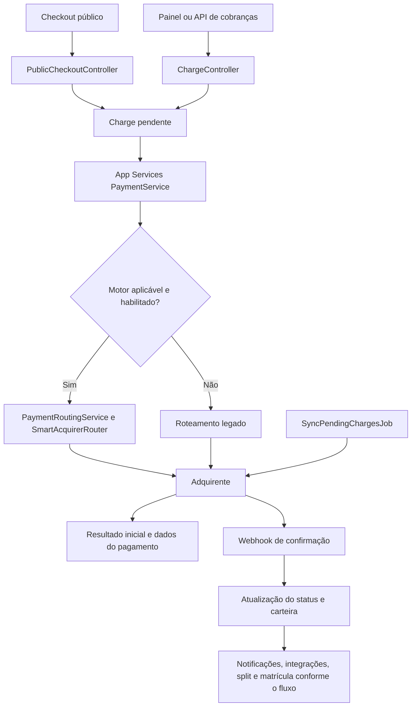

# Mapa técnico do Vector Pagamentos

Análise realizada em 28/09/2026 sobre a árvore de trabalho local, incluindo alterações ainda não commitadas.

Este documento registra a arquitetura, os módulos e os principais caminhos de execução para orientar novas funcionalidades. A análise combinou inventário do código, leitura de rotas, modelos, serviços, controladores, configurações e verificações estáticas. Não representa revisão linha a linha de todos os arquivos nem validação de transações reais, banco implantado ou credenciais de integrações.

## 1. Estrutura e tecnologias

| Parte | Implementação observada |
| --- | --- |
| Interface | React 18, TypeScript, Vite, TailwindCSS |
| Navegação | React Router em `frontend/src/App.tsx`, páginas carregadas sob demanda |
| Estado e consultas | Zustand, React Query, Axios |
| API | PHP, Laravel; Composer permite Laravel 10 ou 11 |
| Persistência | Eloquent; PostgreSQL como padrão da configuração, com outros drivers disponíveis |
| Identificação | UUIDs e `account_id` para vincular dados às contas |
| Autenticação | JWT, chaves de API, MFA e autenticação própria da área de membros |
| Processamento assíncrono | Jobs Laravel, filas configuráveis e tarefas agendadas |
| Infraestrutura versionada | Configurações Nginx, Docker e workflows GitHub Actions |

Inventário: 417 arquivos em `backend/app`, 117 migrations, 43 arquivos em `backend/tests` e 138 arquivos em `frontend/src`. As contagens incluem arquivos auxiliares, não apenas classes ou testes executáveis.

O backend é um monólito modular com arquitetura híbrida. Há camadas `Domain`, `Application` e `Infrastructure`, mas o fluxo principal também usa extensivamente `App\Models` e `App\Services`. O README descreve uma separação mais uniforme do que a implementação atual.

Há um cliente Supabase opcional em `frontend/src/lib/supabase.ts`; a busca em `frontend/src` encontrou as referências a Supabase apenas nesse arquivo. O caminho de dados observado na interface é a API Laravel.

## 2. Módulos e pontos de entrada

Os nomes abaixo são relativos a `frontend/src/pages`, `backend/app/Http/Controllers/Api/V1` e `backend/app/Services`, salvo indicação diferente.

| Módulo | Interface | Backend e responsabilidades |
| --- | --- | --- |
| Cadastro e acesso | `auth/*`, `stores/authStore.ts` | `AuthController`, `AccountRegistrationService`: usuário, conta, carteira, recuperação, Google e MFA |
| Identificação do vendedor | `KYCPage`, `admin/AdminKYC` | `KycController`, `KycMobileSessionController`: documentos, revisão e sessão móvel |
| Produtos e vitrine | `ProductsPage`, `VitrinePage` | `ProductController`, `MarketplaceController`, `Admin/ShowcaseController` |
| Editor de checkout | `CheckoutBuilderPage`, `components/checkout-builder/*` | `CheckoutController`, modelos `Checkout`, `OrderBump` e `Upsell` |
| Compra pública | `public/CheckoutPage`, `components/checkout/*` | `PublicCheckoutController`: produto, cobrança, adicionais, pós-compra e consulta de status |
| Cobranças | `ChargesPage` | `ChargeController`, `PaymentService`: criação, consulta, cancelamento, estorno e sincronização |
| Adquirentes | `AcquirersPage`, `admin/AdminAcquirers`, `admin/AdminAcquirerRouting` | `AcquirerAdminController`, `Admin/AcquirerRoutingAdminController`, serviços de roteamento e adaptadores |
| Saldo e saques | `WithdrawalsPage`, `admin/AdminFinance` | `WithdrawalController`, `WithdrawalService`, `AccountWallet`, jobs de saque |
| Afiliados e divisão de valores | `AffiliatesPage`, `SplitManagement` | `AffiliateController`, `SplitConfigController`, `SplitService`, `Services/Split/*` |
| Cupons | `CouponsPage` | `CouponController`, modelos de cupom e uso; integração com cálculo da compra precisa ser rastreada por fluxo |
| Contestação e conciliação | `ChargebackPage`, `admin/AdminChargebacks` | `ChargebackService`, `ReconciliationService`, controladores e job diário |
| Relatórios e indicadores | `DashboardPage`, `AnalyticsPage`, `ReportsPage`, `CheckoutAnalyticsPage` | `AnalyticsController`, `ReportController`, geração de relatórios e mapa de acessos |
| Domínios e páginas de venda | `DomainsPage`, `LandingPagesPage`, `LandingPageEditorPage` | `DomainController`, `LandingPageController`, `PublicLandingPageController`, resolução de domínio |
| Cursos e alunos | `MemberAreaPage`, `CourseEditorPage`, `members/*` | Controladores `Member*`, `PublicMemberAreaController`, `MemberEnrollmentService` |
| Integrações e notificações | `IntegrationsPage`, `WebhookLogsPage` | Webhooks por conta, n8n, UTMify, Xtracky, Facebook, TikTok e Google Analytics |
| Mensagens e bot | `MessagingPage`, `components/messaging/*` | `MessagingController`, `BotController`, `MessagingInboundController`, `Services/Bot/*` |
| Atendimento | `SupportPage`, `admin/AdminSupport`, `public/BuyerSupportPage` | Tickets do vendedor e tickets públicos de comprador, com controladores separados |
| Assistente IA | `WazerIAPage`, `components/WazerAIChat` | `WazerAIController`, `WazerAIService`, `WazerAIActionService`; integração configurada via OpenRouter |
| Administração | `layouts/AdminLayout`, `pages/admin/*` | Contas, KYC, adquirentes, configurações globais, permissões, segurança e auditoria |

Presença de adaptador, tela ou rota demonstra implementação no repositório; não comprova que a integração está habilitada ou operacional no ambiente implantado.

## 3. Fluxo de pagamento principal

No checkout público, o servidor busca o checkout ativo e seus produtos, calcula valores de produtos e order bumps, associa afiliado quando informado e registra cliente e atribuição de marketing. Em seguida cria `Charge` e chama `App\Services\PaymentService::processPayment`.

O serviço verifica os controles globais de pagamento e método, resolve restrições e prioridades por conta e tenta o motor novo. Se ele não se aplica, continua pelo caminho legado. Portanto, adicionar uma adquirente exige verificar tanto o registro no motor quanto a compatibilidade com os fluxos ainda ativos.

O motor está em `backend/app/Application/Routing/PaymentRoutingService.php` e `backend/app/Domain/Routing`. Ele organiza tentativas, limites de tempo, repetição de falhas transitórias, alternativas, circuit breaker e métricas. `backend/config/acquirer_routing.php` controla habilitação, percentual de tráfego, provedores e mapeamento de saldos. O padrão do arquivo habilita o motor com 100% de tráfego; valores efetivos do ambiente não foram consultados.

PIX pode permanecer pendente após a criação. O sistema recebe confirmação por webhook e também possui sincronização periódica para pagamentos pendentes. Gerar um QR Code não equivale a confirmar o recebimento.

`PaymentService::updateWalletOnPayment` trava cobrança e carteira dentro de transação de banco, calcula taxas por conta/adquirente, registra `fee_amount` e `net_amount` e divide o crédito entre saldo disponível e reserva bloqueada. A condição `net_amount > 0` é usada como marcador de crédito já aplicado. Novas regras de taxas, estorno e saldo devem preservar a consistência desse caminho e verificar seus casos de borda.

Os valores monetários dos modelos centrais são inteiros em centavos. A interface converte para reais na apresentação. Adaptadores de saldo têm mapeamentos explícitos de unidade.

## 4. Outros fluxos importantes

**Cadastro:** `AccountRegistrationService` cria conta pendente, usuário e carteira em uma transação. Depois envia boas-vindas e notificação de KYC pendente. Rotas protegidas aplicam autenticação, estado da conta e auditoria; rotas administrativas acrescentam controles de perfil, MFA e permissão.

**Saques:** o processamento recebe um saque pendente, monta a transferência PIX OUT e seleciona adquirentes. Sucesso no envio leva a `processing`; confirmação posterior leva a conclusão. Há tratamento de falha e restituição de saldo, além de sincronização de transferências. O serviço também contempla partes de transferência. Não implementar nova saída financeira apenas alterando o status no controlador.

**Split:** `SplitService` gerencia regras por conta, produto e checkout, com calculadora e validador de destinatários separados. Há suporte a processamento posterior via `ProcessPendingSplitsJob`. Novas comissões precisam considerar taxas, saldo do produtor, estorno e contestação.

**Área de membros:** produtos podem estar ligados a cursos. Após aprovação, `MemberEnrollmentService` tenta criar ou reativar matrícula, associar usuário e membro e enviar acesso. A interface pública de membros depende também da resolução de domínio personalizado.

**Mensagens:** o webhook de entrada identifica provedor/conta por token e encaminha processamento a jobs. `BotEngineService` resolve conversa e fluxo, aplica horário de atendimento, executa nós ou IA e pode transferir para humano. Retomadas agendadas usam token para descartar esperas obsoletas. A entrega de mensagens fica separada do motor.

**Domínios:** `frontend/src/lib/domain.ts`, `DomainLandingPage` e `ResolveCustomDomain` participam da resolução. Modificar URLs de checkout ou membros exige revisar esse caminho, além das rotas normais do painel.

## 5. Contratos que novas funcionalidades precisam respeitar

| Tipo de mudança | Lugares a revisar |
| --- | --- |
| Nova página do painel | `App.tsx`, layout/menu, serviço HTTP, estado/tipos e endpoint |
| Novo dado persistido | Migration, modelo efetivamente usado, validação, resposta da API e tipos da interface |
| Nova regra de cobrança | Checkout público, `ChargeController`, `PaymentService`, callbacks e sincronização |
| Nova adquirente | Contratos/adaptador, configuração, catálogo/registro, painel administrativo, credenciais, webhook e testes de roteamento |
| Nova taxa ou comissão | Crédito de carteira, split, estorno, chargeback, saque e relatórios |
| Novo evento externo | Serviço de dispatch, job, assinatura, repetição e logs |
| Nova automação do bot | Metadados dos nós, editor, motor, persistência da conversa e retomada |
| Nova entrega de curso | Associação produto/curso, matrícula, autenticação do membro e revogação/reativação |

`backend/routes/api.php` separa rotas públicas, autenticadas por JWT ou API key, administrativas, externas em `/api/v1/external` e de membros. Reutilizar um controlador não dispensa conferir os middlewares de cada grupo.

`frontend/src/lib/api.ts` centraliza Bearer token, renovação de sessão, tratamento de bloqueio e geração de chave de idempotência para POST. O middleware de idempotência no backend compara payload, usa lock e guarda respostas bem-sucedidas por 24 horas quando uma chave é fornecida. Uma nova ação financeira precisa manter a mesma chave durante repetição da mesma operação.

O escopo por `account_id` deve ser conferido em cada leitura, gravação, job e acesso público. Os modelos não constituem, por si só, prova de isolamento automático entre contas.

## 6. Pontos encontrados para tratar antes de ampliar os fluxos afetados

As constatações abaixo vêm do código local e de verificações estáticas; os efeitos em ambiente real não foram reproduzidos.

| Ponto | Evidência | Consequência para desenvolvimento |
| --- | --- | --- |
| Processamento externo divergente | `PaymentController::process` chama `processPaymentMethod`, que retorna sempre `failed`; a rota `/external/payments/{chargeId}/process` está registrada | Integradores que usam esse endpoint não seguem o processamento real de `ChargeController`/`PaymentService` |
| Captura sem chamada ao provedor no método | `PaymentController::capture` cria captura `approved`, gera identificador local e marca cobrança paga | Revisar esse contrato antes de oferecer captura de pré-autorização; o método não comprova captura na adquirente |
| Variável indefinida na matrícula | `MemberEnrollmentService::createAutomaticEnrollment` usa `$tempPassword` nas linhas 101 e 116, sem atribuição no método | Pode interromper o fluxo de criação do membro/envio de acesso depois de criar matrícula |
| Frete fora do cálculo da cobrança observado | `ShippingQuoteController` fornece cotação e `ModernSplitCheckout` calcula frete visual; `PublicCheckoutController::process` soma produtos e bumps sem incorporar frete | Concluir cálculo e validação no servidor antes de depender do valor exibido para venda física |
| Mais de uma implementação de pagamentos e entidades | `App\Services\PaymentService` e `Application\Payment\Services\PaymentService`; modelos semelhantes em `Models` e `Domain` | Confirmar namespace e chamadores antes de alterar uma regra; o handler Stripe também referencia a camada Application |
| Falhas de tipagem existentes | Verificação TypeScript retornou 26 erros em 8 arquivos | A etapa de TypeScript prevista no CI não passa no estado local analisado |

Arquivos com erros de TypeScript: `AffiliatesPage.tsx`, `ChargesPage.tsx`, `CheckoutBuilderPage.tsx`, `KYCPage.tsx`, `LandingPagesPage.tsx`, `public/CheckoutPage.tsx`, `ReportsPage.tsx` e `stores/authStore.ts`. Incluem campos opcionais usados sem tratamento, tipos incompatíveis e formato de resposta divergente.

## 7. Operação e validação

O agendador em `backend/app/Console/Kernel.php` inclui saques automáticos, sincronização de saques e cobranças, expiração, saúde das adquirentes, split pendente, detecção de checkout abandonado, limpeza e conciliação diária. Disponibilizar a API sem seus workers e agendador não cobre todos esses comportamentos.

Há testes de autenticação, API keys, checkout, cobranças, PIX, produtos, cupons, afiliados, split, membros, KYC, domínio, saques, segurança e roteamento. `backend/phpunit.xml` prevê SQLite em memória e serviços de teste. A existência desses testes não significa que passaram nesta análise.

Verificações executadas:

- `php -l` em 567 arquivos PHP de `backend/app`, `backend/routes`, `backend/config` e `backend/database`: nenhum erro de sintaxe.
- `node node_modules/typescript/bin/tsc --noEmit --pretty false` em `frontend`: falhou com os 26 erros descritos acima.
- Inventário das alterações Git: já havia modificações e arquivos novos, inclusive bot, frete e suporte ao comprador; foram preservados.

Não foram executados testes de negócio, migrations, build de produção, acesso ao banco ou chamadas a adquirentes. Não foram alteradas regras do sistema. Este mapa foi o único arquivo adicionado pela análise.

Para cada nova funcionalidade, começar pelo fluxo afetado nesta documentação, identificar o modelo/controlador realmente usado e definir o resultado esperado. Depois implementar a mudança completa entre interface, API, persistência e jobs necessários, validando principalmente os estados de falha e repetição quando houver movimentação de valores.
